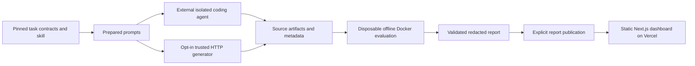

# Architecture and trust boundaries

The public application is a Next.js 16 static export. `app/page.tsx` validates the
published report at build time; the client renders it and accepts browser-local
JSON imports. There is no upload endpoint, execution endpoint, database, AssemblyAI
credential, agent credential or runner in the Vercel deployment.

`scripts/generate.ts` is trusted application code. It makes fixed-destination
HTTPS requests to the Responses API, saves source as inert text, and never
executes generated code. It gives the model neither an AssemblyAI key nor any
shell tool. This adapter is single-turn generation, not a tool-using coding agent.

`scripts/run.ts` imports one bounded regular source file plus bounded JSON metadata
per cell. Prompt hashes must match preparation. Compilation and execution happen
only via `scripts/sandbox.ts` inside the pinned Docker image. Nothing imports a
candidate into the host process. Host calibration imports only the repository's
trusted reference fixture, never user-supplied candidates.

## Isolation controls

- Image content ID is required and recorded; tag-only runs are rejected.
- Non-root UID/GID 10001; all Linux capabilities dropped; no-new-privileges.
- No network; read-only container root; input-only bind mount.
- No repository, home directory, Docker socket, secrets or reference solutions
  are mounted. Only the candidate and public checks enter the container.
- CPU 0.5, memory/swap 256 MB, 64 PIDs, 128 open files; scratch 64 MB and tmp 16 MB
  are tmpfs with noexec/nosuid.
- 30-second wall timeout and 64 KiB combined output bound. Timeout/output overflow
  kills the Docker CLI; a `finally` block then force-removes the named container.
- A fresh temporary input directory for every cell is removed on completion/failure.
- Subprocess environment is allowlisted; known host secrets and obvious
  Authorization/token values are redacted before a report is saved.

Docker is a host-protection boundary, not a proof that arbitrary hostile code
cannot game a public judge. A malicious candidate can inspect public tests or
spoof success markers inside its container. Do not use this judge for adversarial
competitions or financial decisions. Use a stronger out-of-process behavioral
judge and a microVM service before expanding that threat model. Docker itself
and the local daemon are trusted prerequisites. An OS crash or SIGKILL can bypass
language-level cleanup; remove orphan containers with label/name inspection.

## Data and export safety

Reports have a versioned Zod schema, bounded sizes, known tasks/configurations,
unique cells, nonnegative metrics and required measured-result provenance. React
renders text, never imported HTML. CSV cells are quoted and formula-prefixed text
is neutralized. Browser imports stay in memory until reload. No telemetry or
third-party fonts are used. Vercel response headers restrict connections to the
same origin and disable microphone/camera access.

Do not treat redaction as a DLP guarantee for unknown secret formats. Review
reports before public publication. Never put permanent keys into candidate
inputs. The authenticated smoke runs as a separate local CLI and discards its
temporary token. Its result is not silently merged into an offline report.

## Reproducibility boundaries

Exact dependency versions are in package-lock.json. The lock records the official
skill Git commit/content hash, observed SDK version, image ID, budgets and task
order seed. Reports include source commit, lock/task hashes and image ID; rows
include prompt/source hashes, exact reported model and adapter version, tokens,
combined generation+evaluation latency, estimated cost, phase and bounded trace.

Costs are estimates from caller-supplied rates, not invoices. External metadata
is self-reported. The task-order seed does not seed provider generation. Model
backend changes and stochastic output prevent bit-for-bit replay of generation;
evaluation of identical artifacts in an identical image is the deterministic part.
